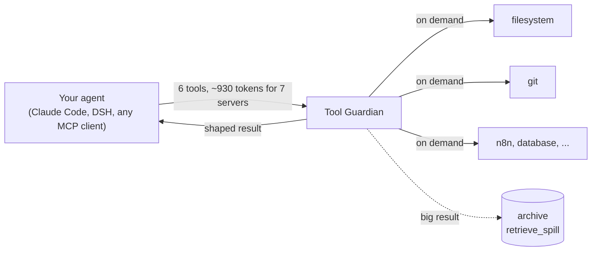

<h1 align="center">Tool Guardian</h1>

<p align="center"><b>Seven MCP servers for 951 tokens instead of 20,005 &mdash; and tool results that stop flooding the window.</b></p>

<p align="center">For local models served by Ollama, LM Studio, vLLM or llama.cpp: the router never talks to the model backend, so any of them works when your client's model calls tools.</p>

<p align="center">Measured on DeepSeek Harness with qwen3-coder:30b, 8 tasks: sessions that ended on a tool call written as text instead of made<br><b>7/16 &rarr; 0/32</b> (16 sessions on 0.4.0-beta.2, 32 on 0.5.0-beta.1; the repair runs in the DSH bundle, see the <a href="CHANGELOG.md">CHANGELOG</a>).</p>

<p align="center">
  <a href="https://github.com/LuminariSoftwares/tool-guardian/actions/workflows/test.yml"></a>
  <a href="https://github.com/LuminariSoftwares/tool-guardian/actions/workflows/privacy.yml"></a>
  
  
  
  
  
</p>

mcp-name: io.github.luminarisoftwares/tool-guardian

<p align="center">
  <a href="#works-with">Works with</a> &middot;
  <a href="#install-both-deepseek-harness-about-5-minutes">Install both</a> &middot;
  <a href="docs/first-5-minutes.md">First 5 minutes</a> &middot;
  <a href="#why-this-exists">Why</a> &middot;
  <a href="#two-ways-to-run-it">Two ways to run it</a> &middot;
  <a href="#install">Install</a> &middot;
  <a href="#see-what-it-saves">Measure it</a> &middot;
  <a href="#it-keeps-tool-results-small-too-030">Output ladder</a> &middot;
  <a href="#native-deepseek-harness-dsh-bundle">DSH bundle</a> &middot;
  <a href="#compatibility">Compatibility</a> &middot;
  <a href="CHANGELOG.md">Changelog</a>
</p>

An MCP server that sits in front of your other MCP servers and exposes **four small generic tools** (list, search, describe, call) instead of dozens of specific ones — discovering the rest **on demand** — so tool definitions stop eating your context window before the model reads a word.

Companion to [Context Guardian](https://github.com/LuminariSoftwares/context-guardian): **Context Guardian compacts the conversation before the window fills; Tool Guardian keeps the tools from filling it in the first place.** Two halves of the same problem.

| | Without Tool Guardian | With it |
|---|---|---|
| 7 MCP servers on a 32K model ([bench](#measured-savings)) | **20,005 tokens** of schemas on every request (61 % of the window) | **951 tokens** (3 %); a schema is fetched only when the model asks |
| A 50 KB shell result | 51,165 characters land in the conversation | **7,833 characters**, the full original archived and one call away |
| DSH first request (measured) | 46 tools, 37,154 characters of schema | **22 tools, 18,503 characters** |
| A backend that fails to start | an empty tool list the model silently works around | status `UNKNOWN` plus the real error (e.g. `could not start: …`), never an empty list |

## Works with

`pip install tool-guardian`, then one entry in your client. Every example below starts the same command, `tool-guardian`,
which reads `~/.tool-guardian/mcp.json`: `tool-guardian-setup import` fills it from the servers you already use.

| Client | Example | Where it goes | Tested |
|---|---|---|---|
| **Claude Code** | [`project.mcp.json`](examples/claude-code/project.mcp.json), hook: [`settings.json`](examples/claude-code/settings.json) | `claude mcp add --scope user tool-guardian -- tool-guardian`, or copy to `.mcp.json` in a project (Claude Code asks once to approve a project server); the hook goes in `~/.claude/settings.json` or `.claude/settings.json` | 2.1.296: full turn; hook in a live session |
| **OpenCode** | [`opencode.json`](examples/opencode/opencode.json) | `opencode.json` in the project, or `~/.config/opencode/opencode.json` | 1.18.35: full turn |
| **Cline** | [`cline_mcp_settings.json`](examples/cline/cline_mcp_settings.json) | VS Code: Cline &rarr; MCP Servers &rarr; Configure MCP Servers; CLI: `~/.cline/data/settings/cline_mcp_settings.json` | CLI 3.0.70: full turn |
| **Continue** | [`tool-guardian.yaml`](examples/continue/tool-guardian.yaml) | `.continue/mcpServers/` in the workspace (IDE), or its `mcpServers` entry in `config.yaml` | `cn` 1.5.47: full turn (entry in `config.yaml`) |

**What "full turn" means.** On Linux, 2026-10-10, each client got the example's `tool-guardian` entry unchanged
(Claude Code through `claude mcp add-json`; OpenCode and Continue with a test model provider added beside it; Cline the
file as is) and talked to a scripted model ([`tests/clients/mock_model.py`](tests/clients/mock_model.py), no real model, no API key). The client
sent tool-guardian's router tools to the model. The model's `list_capabilities` call went through tool-guardian to a stub
MCP server, and the answer came back to the model. tool-guardian's call log recorded the client by name (`claude-code`,
`opencode`, `@cline/core`, `continue-cli-client`). Re-run it: `pip install -e .` then `python tests/clients/run_clients.py`.
This proves the wiring, not that *your* model will use the router: see [Model requirement](#model-requirement-read-this-before-you-switch).

**The Claude Code hook in a live session.** The hook command from [`settings.json`](examples/claude-code/settings.json)
with `--mode deny` added (wrapped to record its input) blocked a Bash call naming a router tool inside a running Claude
Code 2.1.296 session. Claude Code
showed the hook's reason, `Use call_tool(server="probe", tool="tg_live_probe_tool", args={...}) instead of the shell`, and
the call log got its `bypass` row. The payload Claude Code sent is a test fixture now
([`tests/test_claude_code_hook.py`](tests/test_claude_code_hook.py)), next to the example from Claude Code's hook docs.

Not tested yet: the Cline VS Code extension (same file name and shape; tested through the Cline CLI), Continue's
`.continue/mcpServers/` folder (read by the IDE extension; `cn` reads only `config.yaml`), and client runs on Windows or
macOS (the unit tests run on all three in CI). On Windows, if a client cannot find `tool-guardian`, put the full path from
`where tool-guardian` in the `command`.

<!-- shared "install both" block: keep identical to the Context Guardian README -->
## Install both (DeepSeek Harness, about 5 minutes)

Context Guardian and Tool Guardian are two halves of one problem: **Tool Guardian** keeps tool schemas and tool results from filling the window, and **Context Guardian** compacts the conversation before it fills and keeps what matters. They share no files and install separately. You need DSH 0.1.2-alpha.2 or later, Node.js `^22.19` or `>=24`, and Python 3.9+ on `PATH` for Tool Guardian's router.

```bash
# 1. Add both bundles to the DSH profile you use (`web` is the one `dsh web` uses)
dsh plugin --profile web add dsh-tool-guardian
dsh plugin --profile web add dsh-context-guardian

# 2. Tool Guardian: copy in the MCP servers you already use (Claude Desktop / Cursor / Windsurf / .mcp.json), then check them
cd ~/.dsh/profiles/web/node_modules/dsh-tool-guardian          # Windows: cd %USERPROFILE%\.dsh\profiles\web\node_modules\dsh-tool-guardian
npm run setup                  # asks before it writes ~/.tool-guardian/mcp.json, then prints a doctor report

# 3. Context Guardian: add its compaction row to your agent preset (a dry run until --apply)
cd ~/.dsh/profiles/web/node_modules/dsh-context-guardian       # Windows: cd %USERPROFILE%\.dsh\profiles\web\node_modules\dsh-context-guardian
npm run setup
npm run setup -- --apply

# 4. Start DSH and open a NEW session with the preset setup named
dsh web
```

In that session, type `/guardian`. It shows Context Guardian's engine revision and your model's window. Then type `/toolguardian`. It shows each MCP server Tool Guardian started, the tokens the router saves on every request, and whether an update is out.

Not on DSH? Context Guardian's proxy (`python context_guardian.py`, see its README) works with any OpenAI-compatible CLI. Tool Guardian runs as a plain MCP server for Claude Code, Cursor or any MCP client (see its README).

New to it? [Your first 5 minutes](docs/first-5-minutes.md) goes from nothing installed to proof that your model uses the router, on DSH or Claude Code.

## Why this exists

MCP tool definitions are re-sent on **every single request**, whether the model touches them or not. A handful of servers routinely comes to tens of thousands of tokens — often most of a small local model's window — before the first user message. On one real setup, seven MCP servers came to **28,689 tokens, 87.6% of a 32K window**, as a fixed floor under everything else.

You have two ways to deal with that today, and both cost you something:

| Approach | The cost |
|---|---|
| Load fewer MCP servers | You lose the capability entirely |
| Live with it | Two-thirds of the window is gone before you type |

Tool Guardian is a third option that costs neither. It fronts all your servers and shows the model just four small tools plus a one-line catalogue of server names (951 tokens with seven servers behind it, measured below). The full schema for a tool is fetched only when the model asks for it:

```
list_capabilities(server?)      one line per tool — names and purpose
describe_tool(server, tool)     the full argument schema for ONE tool
call_tool(server, tool, args)   invoke it, return the result
```

Same idea as a search index: cheap catalogue always visible, detail on demand.

Every tool carries the MCP annotations (`title`, `readOnlyHint`, `destructiveHint`, `idempotentHint`, `openWorldHint`). All of them are read-only except `call_tool`, which is marked destructive and open-world because it runs whatever the backend tool does; the DSH bundle's `tg__*` direct tools carry the same values.

## Model requirement (read this before you switch)

The whole design rests on one behaviour: the model must **proactively call `list_capabilities` (then `call_tool`) when it needs a tool.** Capable/frontier models do this reliably. Small local models are less certain — and, as the two measurements below show, **the harness the model runs in matters as much as the model.**

**Measurement 1 — August 2026, OpenClaude, router mounted over MCP.** Against a real multi-server stack, **gpt-oss:20b and qwen3-30b-a3b both bypassed the router** on ordinary tasks — even with the `NEXT STEP` nudge in every result *and* a dedicated router sub-agent priming them. They treated a tool name as a shell command or scripted their way around it. Part of that was the harness, not the models: gpt-oss:20b did call `list_capabilities` correctly but could not carry the discovery into `call_tool` inside a general task, and the one approach that completed the sequence (the sub-agent) was blocked by the harness's own agent-tool argument validation before it ever reached the router.

**Measurement 2 — 2026-09-19 and 2026-09-21, DeepSeek Harness, router tools registered natively by the [DSH bundle](#native-deepseek-harness-dsh-bundle).** The same model family (`qwen3:30b-a3b-instruct-2507`, 32K window) **used the router with no bypass.** 09-19, two sessions whose prompts named the tools: `list_capabilities` once, then `list_capabilities` ×8 → `call_tool(ops-scripts, service_status)`. 09-21, one session, three ordinary prompts that named no tool ("Which of the project's services are running right now?", "How many n8n workflows do we have, and which were edited most recently?", "What did we learn last time a bridge commit wrote stale bytes?"): the call log shows `list_capabilities(jobs)` → `call_tool(jobs, pipeline_status)`, then `call_tool(n8n, list)` (wrong name, `ok: false`) → `call_tool(n8n, n8n_list_workflows)` (`ok: true`, 12,963 chars shaped by the ladder) — the model corrected itself from the router's error — and **zero `bypass` rows**; the third prompt was answered with the companion plugin's `recall`/`search` plus built-in `glob`/`read`, which is the right tool, not a bypass. That is three sessions and one model: enough to show Measurement 1 is **not a verdict on these models**, not enough to promise yours will behave.

So: `--selftest` proves the *saving* and that your backends start — it does **not** prove your model will drive the router in your harness. **Test discovery→call with your actual model and harness before committing**, and measure rather than guess: every router call is appended to `~/.tool-guardian/calls.jsonl` (`TOOL_GUARDIAN_CALL_LOG`) with a session id, and under DSH a shell call that does a router tool's job is logged there as `kind: "bypass"` (and can be nudged or denied). After a few real tasks, **`/toolguardian bypass`** (DSH) or **`tool-guardian --bypass-summary`** (any client) reads that file for you: router calls, every bypass with the exact `call_tool(...)` it should have been, and sessions that never touched the router. Over plain MCP, see [bypass detection and its limits](#bypass-detection-over-plain-mcp-and-its-limits). If it won't, expose a small *curated, visible* subset of servers instead of routing everything behind a catalogue the model never opens.

## Two ways to run it

It is one repo and one Python router. Pick the front door that matches your harness — both stay supported.

| | **MCP server** (any MCP client) | **Native DSH bundle** |
|---|---|---|
| Works with | Claude Code, OpenCode, Cline, Continue ([tested configs](#works-with)), Claude Desktop, OpenClaude, Cursor, anything that speaks MCP over stdio | [DeepSeek Harness](https://github.com/deepseek-ai/deepseek-harness) |
| Install | `pip install tool-guardian` | `dsh plugin --profile <name> add dsh-tool-guardian` |
| Hides MCP schemas behind 6 router tools (8 with [skills](#skills)) | yes | yes, registered natively |
| Output ladder on results | results of `call_tool` | **every** tool's result (`bash`, `grep`, `web_fetch`, ...) |
| Tool groups with token prices | `list_groups_with_costs` | plus `activate_group`, and DSH's own built-in tools can be grouped and hidden too |
| Notices a shell call doing a router tool's job | — | logs, nudges or denies it |
| Configured by | `tool-guardian.json` + `TOOL_GUARDIAN_*` env | the `tool-guardian` patch row or DSH settings; the same env vars win |



## Where it sits

```
your CLI / agent (Claude Code, OpenClaude, any MCP client)
    -> Tool Guardian          (this project — one MCP server)
        -> your real MCP servers (filesystem, git, n8n, database, ...)
```

You point your client at **one** MCP server — Tool Guardian — and give Tool Guardian the same `mcpServers` config you'd have given the client. It starts your servers, keeps them warm, and proxies calls through on demand.

## Install

```bash
pip install tool-guardian
```

Pure standard library — nothing else to install.

> PyPI and npm now ship the same code: `pip install tool-guardian` (0.3.0+) for the MCP server, `dsh-tool-guardian` on npm for DSH.

## Configure

**Quickest way:** you probably already have your servers set up in another MCP client.

```bash
tool-guardian-setup import    # copies them from Claude Desktop / Cursor / Windsurf / .mcp.json, asks before writing
tool-guardian-setup doctor    # checks the config, each server's command, your .env and ${VARS}, and says how to fix each problem
```

**Adding one more server is one command** -- everything after `--` is the server's command line, exactly as you would type it:

```bash
tool-guardian-setup add git -- uvx mcp-server-git
tool-guardian-setup add github --env GITHUB_TOKEN='${GITHUB_TOKEN}' --description "issues and PRs" -- npx -y @modelcontextprotocol/server-github
tool-guardian-setup list      # name, command, and the group each server's tools land in
tool-guardian-setup remove git
```

`add` writes to the same config `doctor` finds (under DSH that is `$TOOL_GUARDIAN_CONFIG`), backs it up first, refuses a
name that already exists unless you pass `--replace`, checks the command is on your PATH, warns about any `${VAR}` that is
not set in your environment or `.env`, and ends with the doctor result for that one server. Then restart your MCP client
(or start a new DSH session) to load it.
Every server you add is automatically behind the router's 6 tools: with no groups config it gets its own group named
after the server; with a custom groups config it lands in `other` until you add it to a group.

`import` writes `~/.tool-guardian/mcp.json` (backing up any existing file), skips what it can't route yet
(HTTP/SSE servers) and prints the one entry to put in your client instead. Inside DSH (npm install) run the
same thing as `python <plugin folder>/tg_setup.py doctor`.

Or write the config by hand:

Tool Guardian reads the **standard** `mcpServers` block (the same shape Claude Desktop / Claude Code and most MCP clients use):

```json
{
  "mcpServers": {
    "files": {
      "command": "npx",
      "args": ["-y", "@modelcontextprotocol/server-filesystem", "/data"]
    },
    "git": {
      "command": "uvx",
      "args": ["mcp-server-git"],
      "description": "git status / diff / commit / log"
    }
  }
}
```

An optional per-server `"description"` enriches the catalogue the model sees. Without one, the hint is derived from that server's own tool names at startup.

Config is searched in order: `--config PATH`, `$TOOL_GUARDIAN_CONFIG`, `./mcp.json`, `./.mcp.json`, `~/.tool-guardian/mcp.json`.

## Environment and `.env`

Tool Guardian loads a `.env` itself and expands variables in your backend
args, so secrets don't have to be exported into the environment by whatever
launches it.

- **`.env` autoload.** On startup it looks for a `.env` in this order: an
  explicit path, `$TOOL_GUARDIAN_ENV`, then an **upward search** — starting at
  the config file's directory (or the cwd) and walking up to 5 parent
  directories, loading the first `.env` it finds. This lets your config live
  in a nested folder while the `.env` sits at the project root. Values already
  in the real environment win over the file, and the `TOOL_GUARDIAN_*` settings
  themselves can live there too; a missing `.env` is a no-op,
  never an error.

  Example — config nested under the project, `.env` at the root:

      myproject/
      ├── .env                 <- (3) found here, loaded, search stops
      └── config/
          └── dsh/
              └── mcp.json      <- $TOOL_GUARDIAN_CONFIG points here

  The search walks upward from the config's directory:

      1. myproject/config/dsh/.env    -> not found
      2. myproject/config/.env        -> not found
      3. myproject/.env               -> FOUND  (stops here)

- **Small-window preset.** `TOOL_GUARDIAN_PRESET=small` is for 8k-context local
  models. It sets exactly two values:

  | setting | default | `small` | what it does |
  |---|--:|--:|---|
  | `TOOL_GUARDIAN_CATALOGUE_CHARS` | 0 (no cap) | 1500 | each server's block in `list_capabilities` is cut at this many characters, with a `[+N more tools not shown ...]` line pointing at `search_capabilities` |
  | `TOOL_GUARDIAN_DESC_WORDS` | 12 | 6 | words of a tool, server or skill description shown in catalogue and search lines |

  Set either variable to override the preset. Search ranking still scores 12
  description words, the output ladder and every other setting are unchanged, and
  `describe_tool` is compact in both. On the seven bench catalogues the seven
  per-server listings total 9,582 characters with `small` against 16,274 without.

- **Variable expansion.** `${VAR}`, `$VAR` and `%VAR%` are expanded in each
  backend's `args` from the environment; unknown variables are left as-is.
  Keep a secret in `.env` and reference it in a backend arg:

      "args": ["-y", "mcp-remote", "https://app.openseo.so/mcp",
               "--header", "Authorization: Bearer ${OPENSEO_API_KEY}"]

## Run

Point your MCP client at Tool Guardian as a single stdio server:

```json
{
  "mcpServers": {
    "tool-guardian": {
      "command": "tool-guardian",
      "args": ["--config", "/path/to/your/mcp.json"]
    }
  }
}
```

Everything your servers can do is still reachable — the model just discovers it in two steps (`list_capabilities` → `call_tool`) instead of paying for all of it up front.

### A backend that exits or stops answering

When a backend's process exits, or a call gets no reply within `TOOL_GUARDIAN_CALL_TIMEOUT`, the router stops it and
starts it again before the next call: after 1 s the first time, 5 s on any later respawn, re-sending the `initialize`
handshake. A second failure within 60 s marks the backend `DOWN` and it is not restarted again. The count is
`backend_respawns` in the bridge's `stats` and the `backend respawns: N since load` line of `/toolguardian`.

## See what it saves

```bash
tool-guardian --selftest
```

Starts your configured servers, prints the catalogue, and reports the tokens the router tools cost versus loading every server's tools directly — e.g. *"router tools cost ~310 tokens vs ~28,700 for the full set behind them → ~28,390 freed on every request."* Below the totals it prints one `[server] N tools, ~M tokens` line per server, and it exits non-zero if any configured server failed to start. It ends with one `update:` line (a newer release, "none", or "could not check"); `tool-guardian-setup doctor` ends with the same line. The check runs at most once a day, is silent on failure, and is off with `GUARDIAN_NO_UPDATE_CHECK=1`.

Token counts use `tiktoken` (cl100k_base) when it is importable and the characters ÷ 3.5 estimate otherwise; the report prints which, e.g. `token counts: estimate (chars / 3.5; tiktoken not available)`. `pip install tiktoken` switches it; nothing else needs it.

### Prove your model drives the router

```bash
TOOL_GUARDIAN_PROVE_URL=http://127.0.0.1:11434/v1 tool-guardian --prove
```

Sends three bundled prompts to an OpenAI-compatible chat endpoint with the router tools attached, runs the model's tool calls through a real router in front of a bundled stub server, and prints one `PASS`/`FAIL` line per prompt with the prompt and completion tokens the endpoint reported: `list_describe` (list or search, then `describe_tool`), `nested_call` (`call_tool` with a nested filter), `stalled` (the model must reach `call_tool`, not only search). Exit 0 when all pass, 1 on any `FAIL`, 2 when `TOOL_GUARDIAN_PROVE_URL` is not set. Optional: `TOOL_GUARDIAN_PROVE_MODEL` (default: the first id from `GET <url>/models`), `TOOL_GUARDIAN_PROVE_KEY` (bearer token). The servers in your `mcp.json` are not started, and nothing is written to the call log or `state.json`.

Under DSH, type **`/toolguardian`** in a session for the same report from the running plugin: each server's status and tool count, the tokens freed on every request, active groups, ladder and bypass counters, and the update line.

## It keeps tool *results* small too (0.3.0)

Definitions are half the problem; one 40 KB build log is the other half. Every `call_tool` result now goes down a deterministic **output ladder** before the model sees it:

| result | what the model gets |
|---|---|
| under ~1.2k chars, or from a `read`-class tool | untouched, byte for byte |
| an error over 300 chars | head + tail summary |
| JSON array / CSV ≥ 10k | keys, first and last items, counts |
| shell-style output ≥ 8k | head, evenly spaced samples (with line numbers), tail — `[exit code: …]` always kept |
| a unified diff | every change, plus the context right next to it |
| anything else ≥ 1.2k | cleaned losslessly: ANSI stripped, blank runs collapsed, repeated lines counted |

**Nothing is lost silently.** Before any lossy step the full original is archived, the result says so in one line, and the model can call **`retrieve_spill(id, grep=…)`** to read it back. If the archive cannot be written, the original is returned instead. Same input, same output, always — so provider prompt caches keep hitting. `TOOL_GUARDIAN_LADDER=0` turns it off.

`list_groups_with_costs` prices each tool group in context tokens, and every router call is logged (argument *values* never are) to `~/.tool-guardian/calls.jsonl` so you can measure whether your model actually uses the router.

## Skills

The same catalogue-on-demand idea, applied to `SKILL.md` files. Point `TOOL_GUARDIAN_SKILLS` at one or more folders (separated by `:` on Linux/macOS, `;` on Windows); every `SKILL.md` one or two levels below a root is a skill, named by its front-matter `name` (or its folder).

- **`list_skills`** — one line per skill: name and purpose. Its description names every skill, so the model knows they exist.
- **`read_skill(name)`** — the full text of one skill. A name is a name, never a path: `/`, `\` and `..` are refused.

The two tools appear only when at least one skill is found. `tool-guardian --skills-report` prints what the catalogue saves against loading every skill up front.

## Measured savings

Reproduce it yourself: `python bench/bench_tokens.py` (no network, no model; `--json` for machine output). The catalogs are the real `tools/list` answers of seven public MCP servers, recorded in `bench/fixtures/catalogs/`.

| server | tools | tokens of tool schemas |
|---|--:|--:|
| everything | 13 | 1,610 |
| filesystem | 14 | 2,500 |
| github | 26 | 5,094 |
| memory | 9 | 1,347 |
| n8n-mcp | 7 | 2,826 |
| playwright | 25 | 5,443 |
| sequential-thinking | 1 | 1,185 |
| **all seven** | **95** | **20,005** |

**Every request:** 20,005 tokens of tool schemas without tool-guardian, 951 with it (**95.2 % less**). On a 32K-context local model that is the difference between a window that is 61 % full before the conversation starts and one that is 3 % full.

The output ladder on four typical tool results:

| output | tool | before (chars) | after (chars) | how |
|---|---|--:|--:|---|
| 3,000-line build log with one error | bash | 115,945 | 4,540 | head, samples, the error line, tail, exit code |
| 400-item JSON array | http_get | 29,521 | 730 | keys, first and last items, counts |
| 3-hunk unified diff | git_diff | 41,764 | 1,363 | every change plus 2 lines of context |
| 1,500-row CSV | query | 44,882 | 354 | header, first and last rows, counts |

Every shortened result is archived first and can be read back with `retrieve_spill`. Token counts use `tiktoken` (cl100k) when it is installed and a conservative characters ÷ 3.5 estimate otherwise; the table above is the estimate.

## What it costs per task (measured 2026-10-01)

The saving above is **per request**. A tool behind the router has to be found before it can be called, and every extra
model request re-sends the conversation, so what matters for a whole task is *requests per task*. Measured on a real
DeepSeek Harness setup -- qwen3-coder:30b (Ollama, 64K window), 3 servers / 26 tools, 8 read-only tasks x 2 repeats, one
fresh session per task, the same tasks with the servers mounted directly vs. behind tool-guardian:

| | direct mount | tool-guardian 0.4.0 | tool-guardian 0.4.1 |
|---|--:|--:|--:|
| tools in the request header | 64 | 33 | 33 |
| header tokens per request | 17,831 | 10,825 | 10,825 |
| model requests per task | 1.9 | 4.8 | **2.8** |
| est. input tokens per task | 39,692 | 73,609 | **38,089** |
| wall time per task | 41 s | 75 s | 44 s |
| tasks passed (of 16) | 6 | 8 | 7 |

0.4.0 cut every request by 39 % but cost 85 % more per task: the model went search -> describe -> call, and copied the
call-shaped `NEXT STEP` hints as plain text. 0.4.1 puts each hit's arguments into the search result (no describe round
trip) and drops call syntax from the hints; per-task cost is now about even with a direct mount on 3 servers, and the
saving grows with every server you add. Break-even on this setup is ~3.7 requests per task. Pass rates at n = 16 are
inside noise. **When it pays off:** many servers, long sessions, a model that goes search -> call. **When it does not:**
one or two small servers with a model that explores. Reproduce: the harness and raw scores are in the 2026-10-01 entry of
the CHANGELOG.

## It catches the mistakes small models make (0.4.0)

Local models get tool calls *almost* right: a count sent as `"2"`, a required argument left out, a made-up option, the
same failing call repeated until the context runs out. The router now sits in front of those mistakes:

| mistake | what happens |
|---|---|
| a quoted number, `"true"`/`"false"`, a number where text is expected | fixed silently, then sent |
| a required argument missing, a wrong type, a value outside the allowed list, an unknown key on a closed schema | **not sent**; the model gets each problem and a correct example call |
| the same call returning the same result a 3rd time | the result is prefixed with a one-line "repeating this will not change the answer" |
| the same call a 5th time | not run; the model is told to use what it has or say what is blocking it |

Finding a tool is cheaper too: `search_capabilities(query)` returns the few matching `server.tool: description`
lines instead of a whole catalogue. Switches: `TG_VALIDATE_ARGS=0`, `TG_LOOP_GUARD=0`.

### Nested arguments

The checks above walk nested objects and array items too (required keys, types, enum values, closed objects), and a
problem names its full path: `argument 'params.filters[2].op' must be one of: eq, lt, gt`.

### `describe_tool` detail

`describe_tool(server, tool)` returns the compact form by default: `server.tool: one-line description`, a
`required args:` line, and the NEXT STEP line listing every argument (`?` = optional). `detail="full"` returns the
whole tool definition as before. On the seven bench catalogues (95 tools) compact is 25,161 characters against
131,080 for full, 80.8 % shorter. `TOOL_GUARDIAN_DESCRIBE_DETAIL=full` makes full the default.

## Native DeepSeek Harness (DSH) bundle

The same repo is an installable DSH bundle, `dsh-tool-guardian`. The Python router is unchanged — the bundle is a bridge to it, not a rewrite, and the MCP server above keeps working.

```sh
dsh plugin --profile <name> add dsh-tool-guardian        # or a path to a checkout (run `pnpm install` in it first)
dsh --profile <name> --dump-config                        # shows a "# == dsh-tool-guardian" layer
```

Inside DSH it (1) registers the router tools **natively**, so your MCP backends' schemas never enter a request unless you activate their group (`activeGroups`, or the `activate_group` tool, which quotes the token cost first); (2) runs the output ladder on **every** tool's result — `bash`, `grep`, `web_fetch`, all of them — through `tools/post-execute`, so do not mount `dsh-trim` beside it; (3) notices shell calls that do a router tool's job and logs, nudges (default) or denies them (`bypass.mode`). Configure it in the profile's `cordis.patch.yml` by overriding the `tool-guardian` row, or through the DSH settings namespace `tool-guardian`; the existing `TOOL_GUARDIAN_*` environment variables win over both. Python is found at `$TOOL_GUARDIAN_PYTHON`, then a `.venv` beside the package, then `python`/`python3` on `PATH` (3.9+, standard library only).

**Setup and checks.** `npm run setup` in the plugin folder finds Python, imports the MCP servers you already use into `~/.tool-guardian/mcp.json` (asking first) and runs the doctor; the bridge finds that file by itself, so no preset or YAML is edited. In a session, `/toolguardian` is the selftest, `/toolguardian bypass` (or `bypass last`, `bypass 24h`) the bypass summary, and `/toolguardian restore` re-loads the previous session's groups.

**Groups across sessions.** Each `activate_group` is remembered in `~/.tool-guardian/state.json` (`TOOL_GUARDIAN_STATE`; empty disables). The next session is *offered* those groups — a log line, a line in `list_groups_with_costs`, the `restore_groups` tool and `/toolguardian restore` — and never loads them on its own, because every loaded group costs tokens on every request.

**Settings.** There is no card for Tool Guardian in the DSH web UI (DSH draws cards only for plugins that ship a browser bundle); the settings live under `tool-guardian:` in `~/.dsh/settings.yaml` and apply live. [docs/dsh-settings.md](docs/dsh-settings.md) shows every field as a card and the exact precedence order, proven line by line from the code.

The result-shaping design follows [dsh-trim](https://www.npmjs.com/package/dsh-trim) (shuistama, MIT): `next()` first, fail open, archive before anything lossy.

## Bypass detection over plain MCP (and its limits)

Under DSH the plugin sees every shell call before it runs, so a bypass is logged, nudged or denied. **A plain MCP server cannot do that**: it only sees calls addressed to it, never the client's own `Bash`. What the server itself can see, and `tool-guardian --bypass-summary` reports:

- a session that **never called the router** (a `kind: "session"` row is written when a client connects);
- a session that **looked tools up but never called `call_tool`** — the pattern Measurement 1 recorded.

For real bypass detection in **Claude Code**, add its `PreToolUse` hook, which matches shell commands against the router's saved tool names and writes to the same call log (names only, never the command text; any error means "allow"):

```json
{ "hooks": { "PreToolUse": [ { "matcher": "Bash|PowerShell", "hooks": [ { "type": "command", "command": "tool-guardian --hook-pretooluse" } ] } ] } }
```

`--mode deny` / `TOOL_GUARDIAN_HOOK_MODE=deny` blocks the call and tells Claude which `call_tool(...)` to use. The hook is tested against Claude Code's documented `PreToolUse` payload and against a payload captured from a live Claude Code 2.1.296 session, where deny mode blocked the call (see [Works with](#works-with)); [`examples/claude-code/settings.json`](examples/claude-code/settings.json) is the same block. Other clients without a pre-tool hook get the two server-side signals only.

### Hook rules file

```bash
tool-guardian --hook-pretooluse --rules ~/.tool-guardian/hook-rules.json
```

```json
{"deny":  [{"tool": "Bash", "args": {"command": "\\brm\\s+-rf\\b"}, "reason": "no recursive deletes"},
           {"tool": "WebFetch"}],
 "allow": [{"tool": "Bash", "args": {"command": "^git (status|log|diff)"}}]}
```

Rules run before the default behaviour. `tool` is a regex matched against the whole tool name; each `args` key is a
regex searched in that `tool_input` field; every listed key must match. Deny rules are checked first and win: the
call is blocked with `reason` (or a default naming the rule). An allow match skips tool-guardian's own check and lets
the call go on to Claude Code's normal permission flow; it approves nothing. No match, no file, or an unreadable file:
the default behaviour, unchanged. The hook only sees the tools its `matcher` sends it, so widen the matcher (e.g.
`Bash|PowerShell|WebFetch`) for rules on other tools.

## Compatibility

| | Tested on | Expected to work | Notes |
|---|---|---|---|
| DeepSeek Harness (bundle) | 0.1.2-alpha.2, Windows 11 | later 0.1.x | peer `@deepseek-ai/dsh-tools >=0.1.2-alpha.2`, `@deepseek-ai/cordis ^4.0.2`; `/toolguardian` needs DSH's command registry (present in 0.1.2-alpha.2) |
| Node.js (bundle, `npm run setup`) | 22.x on Windows 11 and Linux | `^22.19.0` or `>=24` | the `engines` field |
| Python (router, bridge, setup) | 3.11 on Windows 11 and Linux; CI: 3.11 on Ubuntu, Windows, macOS and 3.9 on Ubuntu | 3.9 – 3.12 | standard library only; 3.10 and 3.12 are not run by CI |
| Operating system | Windows 11 (daily use); Ubuntu, Windows, macOS (CI: pytest and the node tests) | | the client runs in [Works with](#works-with) were on Linux only |
| MCP servers behind the router | stdio | stdio | HTTP/SSE (`"url"`) servers are reported `UNSUPPORTED` |
| Clients (MCP server path) | Claude Code 2.1.296, OpenCode 1.18.35, Cline CLI 3.0.70, Continue `cn` 1.5.47 (one scripted-model turn each, Linux); OpenClaude | Claude Desktop, Cursor, the Cline and Continue IDE extensions, any stdio MCP client | see [Works with](#works-with); the Claude Code hook ran in a live session |
| Models | `qwen3:30b-a3b-instruct-2507` under DSH drove the router (3 sessions) | any model that calls tools | gpt-oss:20b and qwen3-30b-a3b bypassed it under OpenClaude — see [Model requirement](#model-requirement-read-this-before-you-switch) |
| Model backend | Ollama (via DSH / OpenClaude) | any | the router never talks to the model backend; only the model's tool-calling behaviour matters |
| Companion | dsh-context-guardian 0.1.0-alpha.5 | | the two share no files and install separately |

"Tested on" means this repo's test suites plus daily use on the machine it was built on. "Expected to work" is not tested — please open an issue if it does not work for you.

## Design notes (the parts that matter)

- **Failure is loud, on purpose.** A router is a single point of failure: without one a broken server costs you that server; behind one it could cost you all of them. So an unreachable backend is reported as `UNKNOWN` with its real error, **never as an empty tool list**. A model that asks for a server and gets `[]` concludes the capability doesn't exist and quietly works around it — the exact failure this avoids.
- **Built for models, not just machines.** It accepts a tool's `args` as either an object or a JSON string, aliases the near-misses models actually send (`query`/`name` → `server`), and ends every result with the concrete **NEXT STEP** to call — because a model that receives a catalogue and no instruction tends to stop there instead of finishing the task.
- **The catalogue names your servers.** Six unnamed generic tools give a model no reason to believe any capability exists, so it improvises. Naming the servers in the tool description costs a few tokens and is the difference between a catalogue the model opens and six tools it ignores.

## What it does *not* do (yet)

- **stdio servers only.** An HTTP/SSE server (a `"url"` entry) is reported `UNSUPPORTED` — load it directly rather than through here.
- It does not merge or rename tools; it proxies them faithfully. `call_tool(server, tool, args)` reaches the real tool unchanged.
- Over plain MCP it cannot see a client's shell calls; see [bypass detection and its limits](#bypass-detection-over-plain-mcp-and-its-limits).
- It has no card in the DSH web UI; configure it in `~/.dsh/settings.yaml` ([docs/dsh-settings.md](docs/dsh-settings.md)).

## Development

```bash
pip install -r requirements-dev.txt
pytest                                  # includes the contract probes in tests/probes/
pnpm install && node tests/dsh_smoke.mjs && node tests/probe_dsh_mvp.mjs && node tests/probe_setup.mjs
npm run check && npm run test:node
pip install -e . && python tests/clients/run_clients.py   # real clients on PATH vs examples/ (optional)
```

CI runs pytest and the node tests on Ubuntu, Windows and macOS.

## Acknowledgements

- **[dsh-trim](https://www.npmjs.com/package/dsh-trim)** (shuistama, MIT) — the shape of the result-shaping listener: call `next()` first, fail open, archive before anything lossy. Tool Guardian's ladder is an independent Python implementation; no dsh-trim code is included.
- **[DeepSeek Harness](https://github.com/deepseek-ai/deepseek-harness)** — the bundle format and the `tools/pre-execute` / `tools/post-execute` seams the DSH side is built on.
- The [Model Context Protocol](https://modelcontextprotocol.io) — the `mcpServers` config shape is theirs, used unchanged so your existing config works.

## License

MIT — see [LICENSE](LICENSE).
